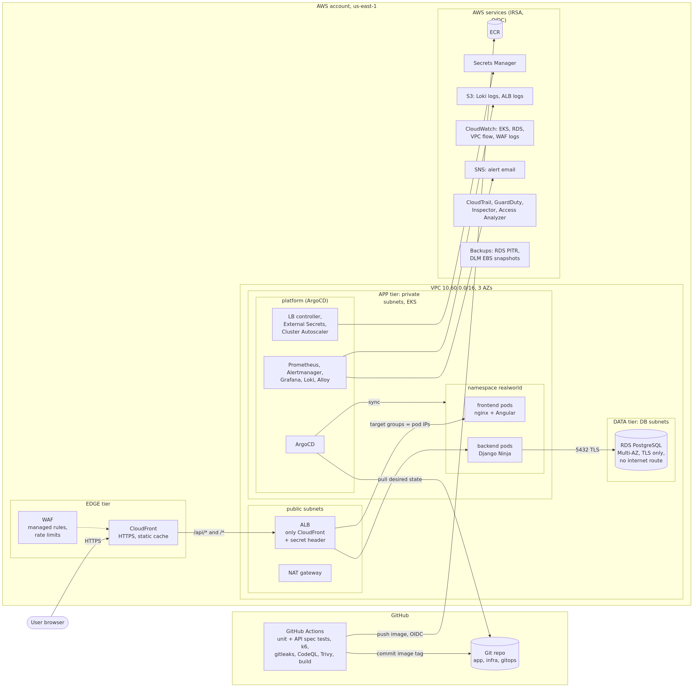
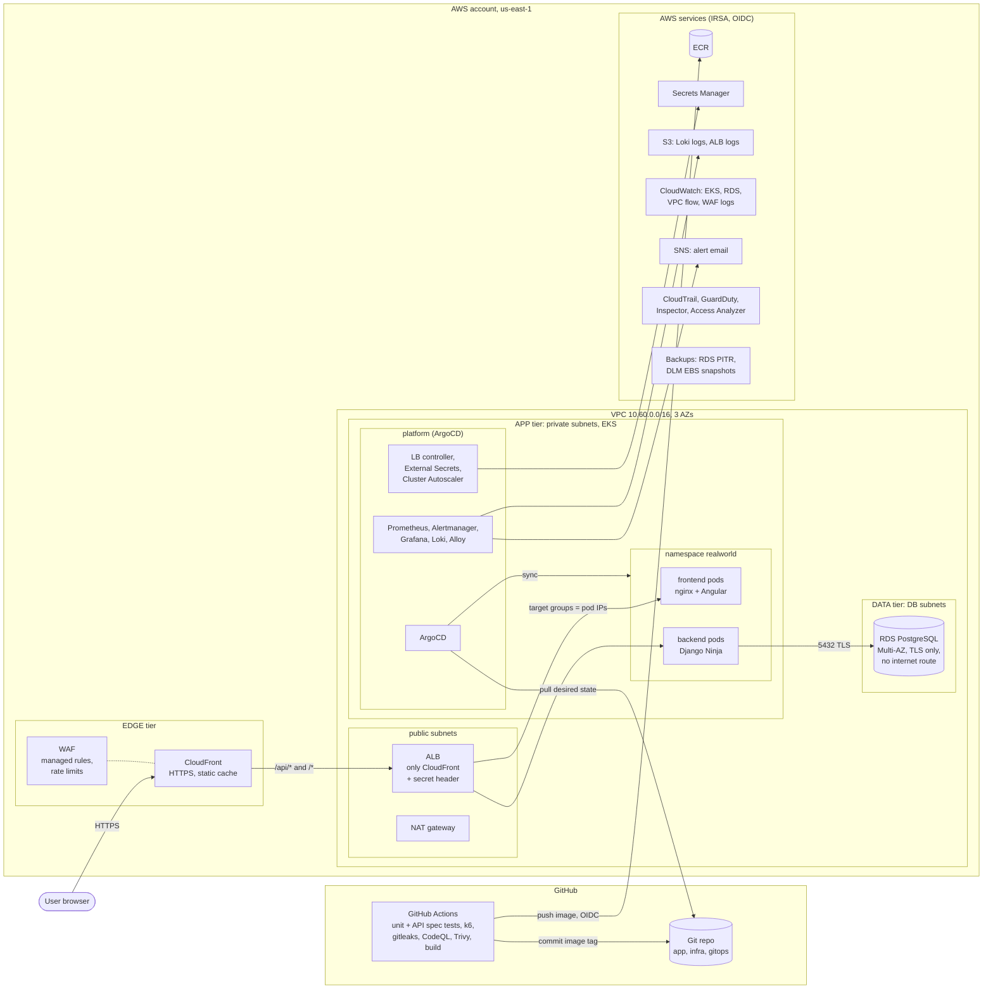

# RealWorld on AWS: continuous delivery platform

Take-home task: a scalable, secure continuous delivery architecture for the
RealWorld (Conduit) full-stack app (Angular frontend, Django Ninja backend)
on AWS EKS, provisioned with Terraform and deployed with GitOps (ArgoCD).


## Architecture



Source: [`docs/architecture.mmd`](docs/architecture.mmd) (Mermaid; GitHub renders it below).

<details><summary>Mermaid version</summary>



</details>

## Repository layout

```
backend/                 Django Ninja API (imported, see below) + Dockerfile
frontend/                Angular app (imported) + Dockerfile (nginx, non-root)
infra/
  global/                once per account: state bucket, GitHub OIDC provider, budget, guard rails
  modules/               reusable building blocks
    network/             VPC, public / private / database subnets x 3 AZ, NAT, endpoints, flow logs
    eks/                 EKS, managed node group, addons, access entries, IRSA OIDC
    irsa-role/           IAM role for one Kubernetes service account
    data/                RDS PostgreSQL (Multi-AZ), its security group and parameters
    edge/                CloudFront + WAF, ALB + target groups, optional domain/TLS
    backup/              AWS Backup plan, vault (lock), cross-region copy
    security/            CloudTrail, GuardDuty, IAM Access Analyzer
    ci/                  ECR repositories, GitHub Actions roles (OIDC)
    observability/       Loki bucket, alerts SNS topic
  envs/
    dev/aws/             composes the modules for one environment
    dev/argocd/          ArgoCD bootstrap: installs ArgoCD + the root Application, nothing else
gitops/
  bootstrap/             app-of-apps chart: one Application per component
  platform/              what ArgoCD installs besides the app (values + manifests)
  charts/realworld/      Helm chart for the app
  envs/dev/values.yaml   per-environment app values; CI bumps image tags here
loadtest/                k6 load test + p95 regression check against main
.github/workflows/       CI (tests, scans, build, deploy), CodeQL, Terraform checks/plan
docs/                    architecture diagram (Mermaid source + PNG)
```

## Application source

| Dir | Upstream | Commit |
|---|---|---|
| backend/ | github.com/c4ffein/realworld-django-ninja (MIT), **this repo is its fork** | 87dd078 |
| frontend/ | github.com/realworld-apps/angular-realworld-example-app (MIT) | ea0dd03 |

This repository is a fork of the backend implementation; its files were
moved into `backend/` with `git mv`, so their history is kept and the diff
against upstream shows exactly what was changed. The frontend is imported as
plain code (no submodules), so the whole delivery lives in one repo.

Changes made for running on EKS:

- backend: `SECRET_KEY` from `DJANGO_SECRET_KEY` (fails to start without it
  unless `DEBUG`), `DATABASE_URL` query options passed to psycopg
  (`sslmode=require`), persistent DB connections, JSON logs to stdout,
  `/healthz` liveness endpoint without a DB call, gunicorn instead of
  `runserver`, multi-stage image running as uid 10001.
  Django 5.2.1 -> 5.2.17 and sqlparse 0.4.4 -> 0.6.0: the image scan found
  fixable HIGH/CRITICAL CVEs (incl. CVE-2025-64459, SQL injection).
- frontend: API calls go to same-origin `/api` instead of a public demo API;
  only the theme CSS and SVGs from the RealWorld repo are vendored
  (`frontend/realworld/assets`); nginx-unprivileged image (uid 101, port 8080).
  Unit tests did not run upstream (zone.js missing, TestBed initialised
  twice); fixed, 180 tests pass.

Both images run with a read-only root filesystem (only `/tmp` writable).

## Tiers

| Tier | What | Where |
|---|---|---|
| Edge | CloudFront, WAF, ALB | public subnets; ALB only accepts CloudFront + secret header |
| Application | frontend + backend pods on EKS | private subnets, egress via NAT |
| Data | RDS PostgreSQL | database subnets, no internet route, SG only from app tier |

## Build order

```bash
# 0. Credentials for the take-home account only (never the default profile)
export AWS_PROFILE=incode

# 1. Account-level resources (local state, creates the state bucket)
cd infra/global && cp terraform.tfvars.example terraform.tfvars   # edit
terraform init && terraform apply

# 2. AWS infrastructure for dev
cd ../envs && cp backend.hcl.example backend.hcl                  # edit
cd dev/aws && cp terraform.tfvars.example terraform.tfvars        # edit
terraform init -backend-config=../../backend.hcl && terraform apply

# 3. ArgoCD bootstrap (after this, git is the source of truth for the cluster)
cd ../argocd && cp terraform.tfvars.example terraform.tfvars      # edit
terraform init -backend-config=../../backend.hcl && terraform apply
```

Every provider pins `allowed_account_ids`, so Terraform refuses to run
against any other AWS account.

## ArgoCD bootstrap

Terraform installs exactly two things into the cluster: the ArgoCD Helm chart
and one root Application (via the `argocd-apps` chart). The root app points at
`gitops/bootstrap`, which renders an Application per component in sync waves:

| Wave | Applications |
|---|---|
| -30 | platform-base (namespaces with Pod Security labels, gp3 StorageClass) |
| -20 | aws-load-balancer-controller, external-secrets, metrics-server, cluster-autoscaler |
| -10 | eso-config (ClusterSecretStore), kube-prometheus-stack, loki |
| 0 | alloy |
| 10 | realworld |

Values that only exist after `terraform apply` (IRSA role ARNs, target group
ARNs, bucket names, secret names) are passed once, as `helm.valuesObject` of
the root app. That is the single hand-off point between Terraform and GitOps.

## CI/CD

```
PR / push ──► backend: ruff + 92 unit tests on PostgreSQL
          ├─► frontend: prettier + 180 unit tests
          ├─► gitleaks (whole git history)
          ├─► trivy config (Terraform, Dockerfiles, Helm; accepted risks in .trivyignore.yaml)
          └─► CodeQL (Python, TypeScript)
                │ all green
                ▼
          build images ──► trivy image (fail on fixable HIGH/CRITICAL)
                       └─► official RealWorld API spec (Hurl, 157 requests)
                           against the built backend image + PostgreSQL
                       └─► k6 load test (backend): absolute p95 / error thresholds,
                           and p95 per endpoint vs the last green run on main
                           (fails above 1.5x: performance regression detection)
                │ main only
                ▼
          push to ECR (OIDC role, tag = git SHA, immutable)
                ▼
          commit new tag to gitops/envs/dev/values.yaml ──► ArgoCD syncs:
          ExternalSecrets ─► migration Job ─► rolling update (maxUnavailable 0)
```

- CI never talks to the cluster and stores no AWS keys: GitHub OIDC for ECR,
  ArgoCD pulls from git (pull-based CD).
- GitHub-hosted runners are enough: nothing in CI needs the private network.
  Self-hosted runners in the VPC would be needed only to plan/apply the
  ArgoCD stack (private EKS API) from CI.
- Infra: `terraform fmt`/`validate` on every change, `plan` on PRs with a
  read-only role; `apply` is manual.
- Third-party actions are pinned to commit SHAs; Dependabot updates them
  together with pip, bun, Docker base images and Terraform providers.

## Design decisions

**Three Terraform stacks, environments as folders.** `infra/global` runs once
per account (state bucket, GitHub OIDC provider, account guard rails);
`infra/envs/<env>/aws` builds one environment from the modules;
`infra/envs/<env>/argocd` only bootstraps ArgoCD. Each has its own state, so a
mistake in one environment cannot touch another. A new environment is a new
folder (`envs/staging`) with its own tfvars and CIDR; in a real setup it would
also be a separate AWS account. `for_each` is used inside an environment
(ECR repositories, ALB to node ingress rules), not to multiplex environments,
and workspaces are avoided because they hide which environment a plan targets.

**Remote state.** S3, versioned, KMS-encrypted, TLS-only, never public;
locking with `use_lockfile` (S3 conditional writes, no DynamoDB table).

**Edge: CloudFront + WAF -> ALB, ALB owned by Terraform.** CloudFront serves
HTTPS, caches static assets and routes `/api/*` uncached to the backend. WAF:
AWS managed rule groups (IP reputation, common, known bad inputs, SQLi), a
login rate limit and a global rate limit. The ALB security group admits only
the CloudFront origin-facing prefix list, and every listener rule requires a
secret `X-Origin-Verify` header that only CloudFront sends. Terraform creates
the ALB and target groups; in the cluster, the AWS Load Balancer Controller
only registers pod IPs into them (`TargetGroupBinding`). The common
alternative, an `Ingress` that makes the controller create the ALB, would make
CloudFront depend on something Kubernetes creates later: two applies and an
ALB outside Terraform.

**Tiers and network.** Public subnets: ALB and NAT only. Private subnets: EKS
nodes and pods (VPC CNI, pods get VPC IPs). Database subnets: own route table
with no internet route; RDS accepts 5432 only from the node security group.
Inside the cluster, NetworkPolicies: default deny, DNS allowed, frontend and
backend reachable only from inside the VPC (the ALB), backend egress only to
PostgreSQL.

**GitOps, pull-based CD.** CI never talks to the cluster: it pushes an image
(tag = git SHA, ECR tags immutable) and commits the tag to
`gitops/envs/dev/values.yaml`. ArgoCD reconciles every 60 s and self-heals
manual drift. Rollback = `git revert` of the tag commit. Deploy order within a
release: ExternalSecrets, migration Job, then a rolling update with
`maxUnavailable: 0`, readiness gates and a PodDisruptionBudget.

**One hand-off from Terraform to GitOps.** Values that exist only after
`terraform apply` (IRSA role ARNs, target group ARNs, DB endpoint, secret
names, bucket names) are passed once, as `helm.valuesObject` of the ArgoCD
root Application. Nothing else in git is environment-generated.

**Identity: no long-lived AWS keys in CI or pods.** GitHub Actions assumes
roles through GitHub OIDC (`gha-build`: only `main` of this repo, only ECR
push; `gha-plan`: read-only). Each cluster component has its own IRSA role,
bound to one namespace/service account. Nodes enforce IMDSv2 with hop limit 1,
so pods cannot borrow the node role. The app's service account mounts no
Kubernetes token.

**Secrets.** AWS Secrets Manager; External Secrets Operator syncs them into
Kubernetes Secrets. The RDS master password is generated and rotated by RDS
(`manage_master_user_password`). Nothing secret is in git.

**Data.** RDS PostgreSQL 18, Multi-AZ, encrypted, `rds.force_ssl=1`, IAM auth
enabled, Performance Insights, slow query log (> 500 ms) to CloudWatch.

**Backups.** Daily: RDS automated backups (daily snapshot + transaction logs,
point-in-time restore for 7 days) and EBS snapshots of the Prometheus and
Grafana volumes (every volume from the gp3 StorageClass is tagged
`Backup=daily`). The design target is AWS Backup with vault lock and a
cross-region copy (`modules/backup`); see the SCP note below. The cluster and
its configuration are not backed up: they are rebuilt from git.

**Observability.** Metrics: kube-prometheus-stack (Prometheus 15 d retention
on a persistent volume, Alertmanager to SNS email, Grafana with persistent
storage). Logs: Grafana Alloy (DaemonSet, reads pod logs through the
Kubernetes API, no hostPath) -> Loki (S3 storage, 30 d, tenant per
environment). AWS-side logs stay in CloudWatch (EKS control plane, RDS,
VPC flow logs, WAF) and S3 (ALB access logs); Grafana has Loki and CloudWatch
as data sources, so one UI covers app, cluster and AWS. The backend logs JSON.

**Security services.** CloudTrail (all regions, log file validation),
GuardDuty (EKS audit logs, RDS login events, S3), Inspector (CVE scanning of
nodes and ECR images), IAM Access Analyzer, Pod Security Admission
`restricted` for the app namespace, read-only root filesystems, non-root
containers with all capabilities dropped.

**Testing.** Unit tests (backend on PostgreSQL, frontend), the official
RealWorld API spec against the built image, k6 with regression detection,
secret scanning, SAST (CodeQL), IaC and image vulnerability scanning. Accepted
IaC findings are listed with reasons in `.trivyignore.yaml`.

**Cost knobs.** `single_nat_gateway`, `db_multi_az`, `enable_interface_endpoints`
and `lab_mode` (no deletion protection, no final snapshot, secrets deleted
immediately, for a lab that is destroyed and re-created). Production values
are the opposite.

### The take-home account's organization SCP

The account belongs to an AWS Organization whose SCP allows only `us-east-1`
and denies `budgets:*` and `backup:*`. The first `terraform apply` failed on
it; `iam simulate-principal-policy` (which includes SCP decisions) mapped what
is allowed. The design is unchanged and kept behind switches:
`enable_budget = false`, `enable_aws_backup = false` (fallback: RDS automated
backups + Data Lifecycle Manager for EBS), single region.

## Known gaps

| Gap | Why / what it would take |
|---|---|
| CloudFront -> ALB is HTTP | No custom domain, so no certificate for the ALB. Setting `domain_name` switches to HTTPS end to end. |
| ALB has a public address | Protected by the CloudFront prefix list + secret header. Better: CloudFront VPC origins (private ALB), which also removes the header secret. |
| Origin header secret is in Terraform state | State bucket is private and encrypted; rotation would be a `terraform apply`. |
| App uses the RDS master user | Should be a dedicated least-privilege DB user (IAM auth). RDS rotates the master password; External Secrets updates the Kubernetes Secret within 1 h, but running pods keep the old value until restarted (needs a reloader or a rollout). |
| `ALLOWED_HOSTS="*"` | Kubelet and ALB health checks use pod IPs as Host. Fix: a health-check-aware host allowlist middleware. |
| No cross-region backup, no restore drill | Region locked by the SCP. A backup that was never restored is not proven; next step is a scheduled restore test. |
| No cost alerting | `budgets:*` denied by the SCP. |
| One NAT gateway | Cost. One NAT per AZ (`single_nat_gateway = false`) removes the AZ dependency. |
| Loki single binary, Alloy without Kubernetes events or node journald | Enough for one small cluster; scalable mode and an events source next. |
| No SLOs or burn-rate alerts | Prometheus has the data (request latency, errors); SLOs per endpoint would be next. |
| `terraform apply` is manual | Plan runs on PRs (`dev/aws`). The ArgoCD stack needs the private EKS API, so applying it from CI needs a self-hosted runner in the VPC (e.g. Actions Runner Controller). |
| Only `dev` exists | Promotion would be a PR that copies the image tag from `envs/dev` to `envs/staging`/`envs/prod`. |
| GitOps state in the app repo; CI commits to `main` | Fine for one team; larger setups split a config repo and protect `main` with a bot exception. |
| ArgoCD, Grafana via `kubectl port-forward` only | No SSO set up; not exposed publicly on purpose. |
| Frontend has unit tests but no browser end-to-end tests in CI | Playwright suite exists upstream; would run against the deployed dev URL. |
| Load test runs in CI on shared runners | Good for relative regressions, noisy for absolute numbers; a nightly run against dev would add realistic numbers. |
| Operator uses an IAM user access key | Lab account. In a company: IAM Identity Center with short-lived credentials. |
| GuardDuty runtime monitoring off | Its agent-managed VPC endpoint blocks VPC deletion on `destroy`; on in a long-lived account. |

## Alternatives considered

- **VictoriaMetrics / Mimir** instead of Prometheus: for long retention and
  many clusters; one cluster for days does not need it.
- **ELK / OpenSearch** for logs: more powerful search, much heavier to run;
  Loki indexes only labels and keeps data in S3.
- **Athena over ALB / CloudFront logs**: useful for traffic analytics; not
  needed for debugging here.
- **Karpenter** instead of Cluster Autoscaler: faster, bin-packing node
  provisioning; Cluster Autoscaler with a managed node group is simpler.
- **Frontend on S3 + CloudFront** instead of nginx pods: cheaper for static
  files; pods keep both components on the same deploy path for this exercise.
- **Argo Rollouts / canary**: rolling updates with readiness gates are enough
  at this size.

## Teardown

```bash
export AWS_PROFILE=incode
cd infra/envs/dev/argocd && terraform destroy
cd ../aws && terraform destroy   # lab_mode = true: no final snapshot
# infra/global keeps the state bucket (prevent_destroy)
```
